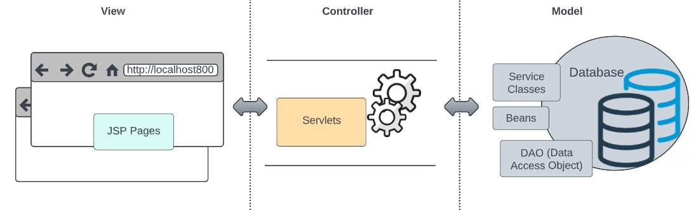
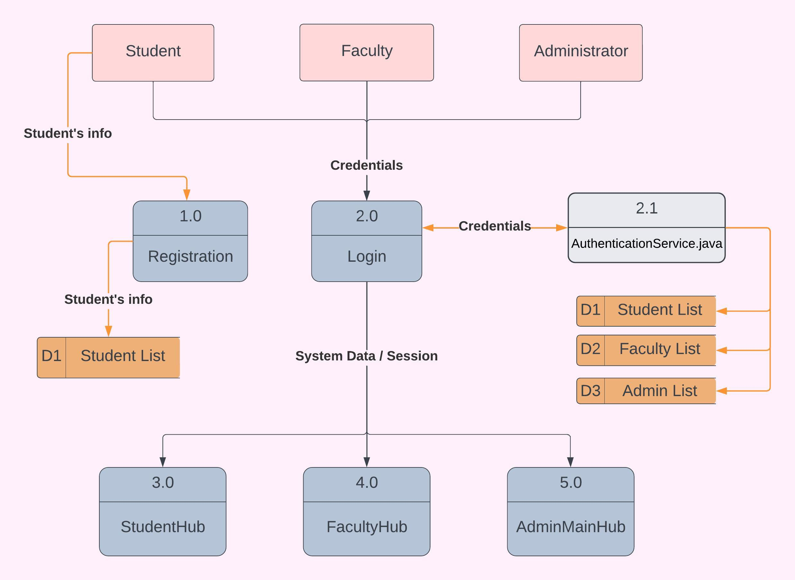
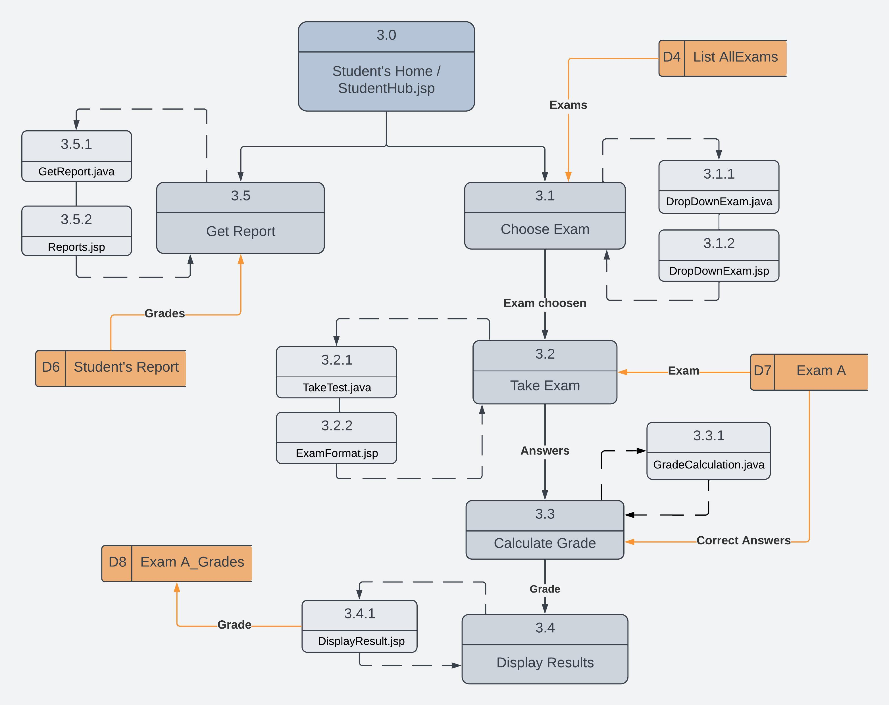
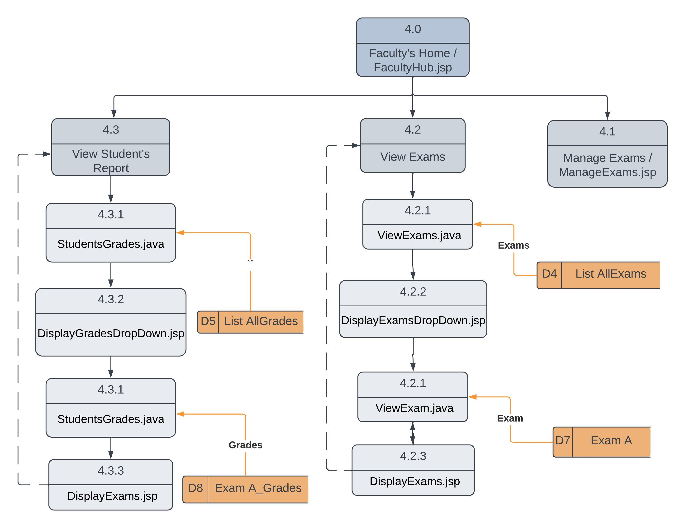
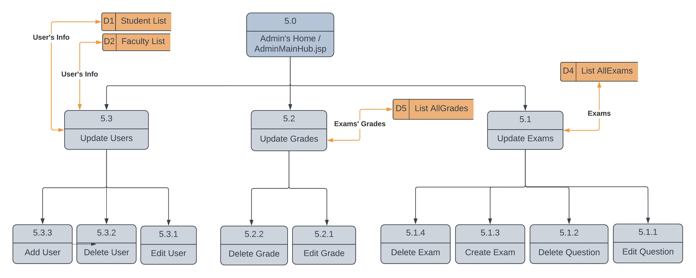

## TestOnlineSystem

## Overview
A Java web application for managing online exams, questions, student grades, and user accounts. The system provides separate interfaces for administrators, faculty members, and students.

The examination management system uses a traditional Java server-side web architecture built around Java Servlets, JSP, and an MVC-style separation of responsibilities

- Controller files
Java Servlets act as controllers, receiving HTTP requests from the browser and coordinating application actions. Each controller handles specific operations, such as user login, registration, exam management, and grade updates.
Servlets process requests using methods such as doGet(), which handles requests to retrieve a page or information  and doPost(), which handles submitted forms, such as login, registration, or grade updates.

- Service Classes files
Handle business logic. Service classes implement application operations and coordinate with the database-access code.


<p align="center">
  
  <br>
  <em>MVC Pattern</em>
</p>

## Features
- Administrator: Create, edit, and delete user accounts; create and manage exams; view and update exam grades; and manage examination-related information.

- Faculty: Create exams, manage exam questions, view available exams, and review student grades.

- Students: Register and log in to the system, view available exams, take online assessments, and view exam results and student reports.

## Technology stack
- **Apache Maven (3.9.1.6)** — Manage dependencies and build the applicaton into a WAR file. 
- **Apache Tomcat (9.0)** — Runs the Java web application and processes HTTP requests to servlets and JSP pages.
- **Java (JDK17)** — Application logic(controllers and services) and backend processing(database).
- **Jakarta/Java Servlets (4.0 - javax,servelt API)** — Provides request handling and server-side application control.
- **JSP (JavaServer Pages)** — Generates dynamic web pages and user interfaces supported by Tomcat 9. 
- **HTML, CSS, and JavaScript** — Frontend structure, styling, and interactions.
- **Oracle Database Free 23c image** — Store user accounts, exams, questions, and grades.
- **Oracle JDBC Driver (21.5)** — Connects Java code to Oracle database through JDBC.
- **JUnit Jupiter (5.10)** — Provides framework for writing and running automated unit testing.
- **Docker** — Containerized application and database environment.
- **Git and GitHub** — For version control and host the project repository.

## Project Structure
<p align="center">
  
  <br>
  <em>DFD 01 - Main Flow</em>
</p>

<p align="center">
  
  <br>
  <em>DFD 02 - Students Flow</em>
</p>

<p align="center">
  
  <br>
  <em>DFD 03 - Faculty Flow</em>
</p>

<p align="center">
  
  <br>
  <em>DFD 04 - Administrator Flow </em>
</p>

## How the Technologies work together:
<p align="center">
  
  <br>
  <em>System Architecture</em>
</p>

1. Java — Application Logic
Implements core functionality, input validation, grade calculations, and database operations. Code is organized into bean, controller, model, and serviceClasses packages.

2. Java Servlets — Request Handling
Handles HTTP requests, invokes service classes, and coordinates application actions. The project uses the javax.servlet API supported by Tomcat 9 (Servlet 4.0).

3. JSP, HTML, CSS, and JavaScript — User Interface
JSP generates dynamic pages, HTML defines page structure, CSS provides styling, and JavaScript handles browser-side interactions. JSP files are organized by user role under src/main/webapp/jsp/.

4. Oracle Database and JDBC — Data Persistence
Oracle stores user accounts, exams, questions, and grades. JDBC connects Java to the database through DatabaseConnection. Credentials are supplied using the DB_USERNAME and DB_PASSWORD environment variables.

5. Apache Maven — Build Management
Uses pom.xml to manage dependencies, run tests, and package the application as target/TestOnlineSystem.war for Tomcat deployment.

6. JUnit 5 — Automated Testing
JUnit Jupiter tests application logic. PercentageTest.java verifies grade percentage calculations through GradeCalculationService.

7. Docker — Containerization
Runs Tomcat and Oracle Database in separate containers connected through a Docker network. The Tomcat container maps host port 8081 to container port 8080, allowing access through the host computer.


## Requirements to build and run the application:
- Java JDK 17
- Apache Maven
- Apache Tomcat 9
- Oracle Database
- Docker, if using the containerized setup

## Configuration
The application uses environment variables for database credentials:

DB_USERNAME=your_database_username
DB_PASSWORD=your_database_password

Set these variables in the environment where Tomcat runs. If using Docker, you can pass them to the container through a local environment file.

The database connection URL currently used by the application is:
jdbc:oracle:thin:@//oracle:1521/FREEPDB1

Make sure the database hostname matches your Docker network configuration.

## Build the Project
From the project root, run:

```bash
mvn clean package
```
Maven builds the application into a WAR file under the `target/` directory.

## Running with Docker
The application can run in an Apache Tomcat container connected to an Oracle database container.
The Tomcat container uses port `8081` on the host, mapped to port `8080` inside the container.
When the application is deployed, open:

```text
http://localhost:8081/TestOnlineSystem/
```
The Oracle database container must be running and accessible on the same Docker network.

## Running Tests
Run the project's automated tests with:

```bash
mvn test
```
JUnit tests are located under `src/test/java/`.


## Author
**Patricia Takara**